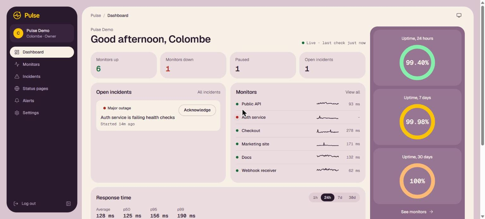
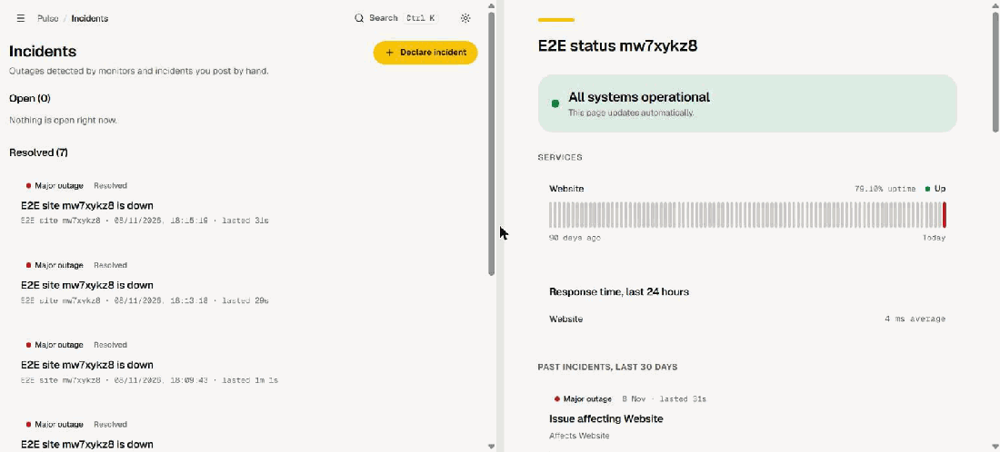
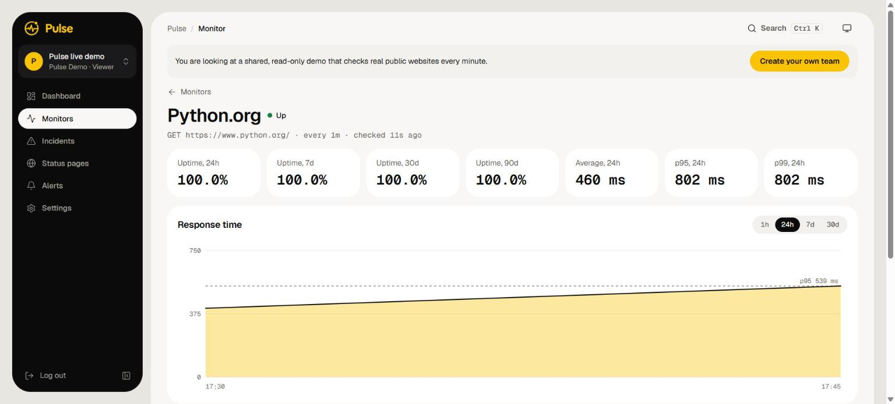
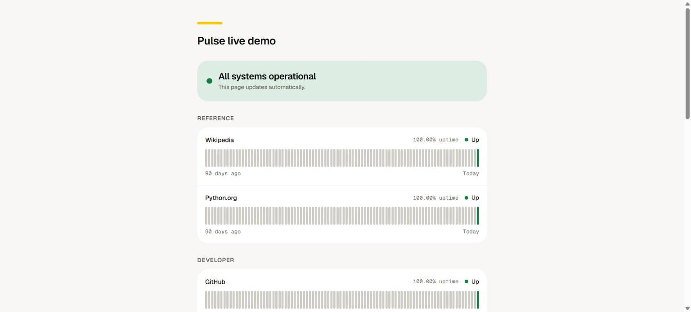
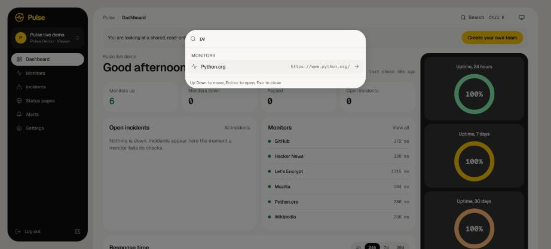
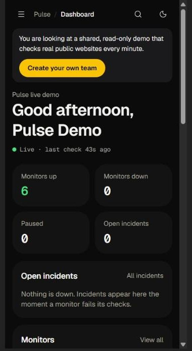
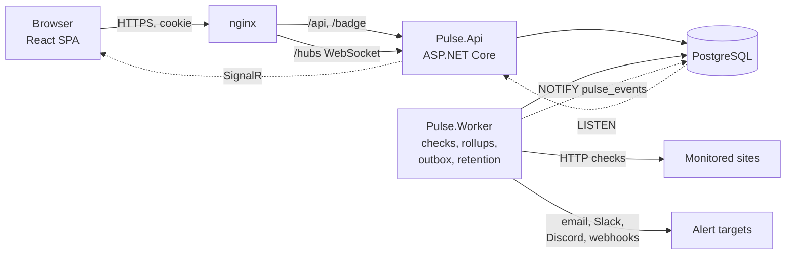

<p align="center">
  
</p>

<p align="center">
  <a href="https://github.com/colombefioren/PULSE/actions/workflows/ci.yml"></a>
  
  
  
  
  
  
  
  
  
  
  
</p>

# Pulse

Pulse checks websites and APIs on a schedule, notices when one stops answering, tells your team by email, Slack,
Discord or webhook, and publishes a live public status page your customers can read and subscribe to. Monitoring
and a status page in one place, on .NET 10, React and PostgreSQL, built so the interesting parts are small enough to read.

**Status: v1.0.0.** Try it with one click on the landing page: "Try the demo" opens a read-only team that watches
real public websites, or a built-in sample workspace when the server has no demo.



## An outage, live

A monitor fails, an incident opens by itself, and the public status page changes while a visitor is looking at it.



| Monitor | Public status page |
| --- | --- |
|  |  |

| Command palette (Ctrl+K) | Dark theme at 360 px |
| --- | --- |
|  |  |

## Run it in three commands

```bash
git clone https://github.com/colombefioren/PULSE.git
cd PULSE
docker compose up --build
```

Open http://localhost:8080, create an account (the confirmation email arrives in Mailpit at
http://localhost:8025), add a URL and watch it go Up within a minute.

| Service | URL |
| --- | --- |
| Web | http://localhost:8080 |
| API | http://localhost:5080 (health: `/health/live`, `/health/ready`) |
| Mailpit | http://localhost:8025 |

Every setting has a development default. Copy `.env.example` to `.env` to change ports or credentials, or to turn
on the shared demo (`DEMO_ENABLED=true`).

## What it does

**Monitors.** Check an `http` or `https` address every 30 seconds to 30 minutes, requiring status codes, a keyword
in the body and request headers. A monitor goes Down after a few failures in a row and Up again after a few
passes, so one dropped packet pages nobody. Each shows uptime for 24 hours, 7, 30 and 90 days, average, p95 and
p99 response times, a chart, and the reason for every failed check.

**Incidents and alerts.** An incident opens when a monitor goes Down and resolves when it recovers, with a
timeline of what was seen, who acknowledged it and any notes. Declare your own for what monitors cannot see.
Alert channels are email, Slack, Discord and a generic webhook signed with HMAC-SHA256; failed deliveries are
retried after 1, 5, 15 and 60 minutes.

**Status pages.** Up to five per team at `/status/your-address`, with components fed by monitors, 90 days of
uptime bars, active incidents with public updates, and email subscribers (double opt-in, one-click unsubscribe).
Visitors need no account. What they see is deliberately plain: an incident from a monitor reads "Issue affecting
Checkout", never the monitor's name, address or error.

**Badges.** Switch on a monitor's badge and paste the Markdown from its page: `/badge/{monitorId}.svg` shows the
last 30 days as a small image. Off by default, cached, rate limited, and a switched-off monitor looks the same as
one that does not exist.

**Teams.** Owner, Admin and Viewer roles, invitations that work for 7 days, and a 404 for anything in a team you
do not belong to, so ids cannot be probed.

**Keyboard.** `Ctrl+K` (`Cmd+K` on a Mac) opens a command palette to jump to any monitor or page, create a monitor,
switch team or change the theme. `C` adds a monitor; `G` then `M` or `I` opens monitors or incidents.

## Architecture



Two processes share one database. `Pulse.Api` serves the web app's API, the public status pages and the live
connections. `Pulse.Worker` runs the checks, sends alerts, rolls results up and drops old data. They never call
each other: anything one needs from the other goes through PostgreSQL. The code follows Clean Architecture
(`Domain`, `Application`, `Infrastructure`, then the two hosts); see [docs/architecture.md](docs/architecture.md).

## Design decisions

The longer reasoning, with the alternatives that were rejected, is in [docs/decisions.md](docs/decisions.md).

- **Partitioned check results, dropped not deleted.** `check_results` grows forever, so it is partitioned by month.
  Retention is `DROP TABLE` on a whole month once all of it is older than 30 days, after the worker has summed it
  into hourly (kept a year) and daily (kept forever) rollups. No `DELETE` ever touches millions of rows, and the
  space comes back at once.
- **Scheduling with `FOR UPDATE SKIP LOCKED`.** Each monitor row carries its next due time. A worker claims a batch
  of due rows in one transaction, moves their due time forward and runs the checks outside it, so any number of
  workers can share the load without a lock manager, and a crashed one just lets rows come due again.
- **A transactional outbox for alerts and mail.** When a monitor changes state, the incident and the "send this"
  message are written in the same transaction. A dispatcher leases messages, sends them with a few retries and marks
  them done, so an alert is neither lost with a crash nor sent for a change that was rolled back. Delivery is at
  least once.
- **SignalR through `LISTEN/NOTIFY`, no broker.** Whoever changes something publishes a `pg_notify`; every API
  instance listens and pushes to its own connected browsers. The public status page's socket carries nothing but
  "changed", and the browser then fetches the cached page like any visitor.
- **Checks cannot be pointed inward.** The address is checked when a monitor is saved and again on every
  connection, redirects included, against the address actually used, so DNS tricks cannot reach the private
  network or a cloud metadata service.
- **Cookie sessions with antiforgery tokens**, not tokens in local storage: the session is `HttpOnly`, and every
  request that changes something carries a header other sites cannot set.

## Develop

Without Docker you need the .NET 10 SDK, Node 24, PostgreSQL 16 and an SMTP catcher such as Mailpit on port 1025.
Start only the dependencies with `docker compose up postgres mailpit`; the Development settings apply migrations on
startup.

```bash
dotnet run --project src/Pulse.Api        # http://localhost:5080, OpenAPI UI at /scalar/v1
dotnet run --project src/Pulse.Worker
cd web && npm ci && npm run dev           # http://localhost:5173, proxies /api to the API
```

### Tests

```bash
dotnet test Pulse.slnx                    # unit and integration; integration tests start PostgreSQL with Testcontainers
cd web && npm run lint && npm run typecheck && npm test
```

Without Docker, point the integration tests at any PostgreSQL server you can create databases on. They create and
drop a scratch database of their own:

```bash
PULSE_TEST_POSTGRES="Host=127.0.0.1;Port=5432;Username=postgres;Password=..." dotnet test Pulse.slnx
```

End-to-end tests drive a real browser against the whole stack, including a website whose health they switch to
cause an outage:

```bash
docker compose -f docker-compose.yml -f docker-compose.e2e.yml up -d --build
cd e2e && npm ci && npx playwright install chromium && npx playwright test
```

Schema changes need a migration: `dotnet ef migrations add <Name> --project src/Pulse.Infrastructure --startup-project src/Pulse.Api`
(the tool is pinned in `dotnet-tools.json`; run `dotnet tool restore` once).

### Settings worth knowing

| Setting | Default | Meaning |
| --- | --- | --- |
| `Demo__Enabled` | `false` | "Try the demo" signs in to a shared read-only team that watches real public sites |
| `Checks__AllowPrivateTargets` | `false` | Lets checks reach private addresses. Only the end-to-end stack sets it |
| `StatusPage__CacheSeconds` | `30` | How long a public page is cached; `0` turns the cache off |
| `Badge__CacheSeconds` | `300` | How long a badge is cached |
| `App__PublicUrl` | `http://localhost:8080` | Where links in emails point |

## Stack

| Layer | Choice |
| --- | --- |
| Backend | .NET 10, ASP.NET Core, Clean Architecture |
| Data | PostgreSQL 16, EF Core with Npgsql |
| Background work | `BackgroundService`, `FOR UPDATE SKIP LOCKED`, a transactional outbox |
| Real time | SignalR, worker events through `LISTEN/NOTIFY` |
| Frontend | React, TypeScript (strict), Vite, Tailwind CSS, Radix UI, TanStack Query |
| Tests | xUnit, FluentAssertions, Testcontainers, Vitest, Testing Library, Playwright |
| Delivery | Docker Compose, GitHub Actions |

## Milestones

| Version | Milestone | Status |
| --- | --- | --- |
| v0.1.0 | M0 Foundations | released |
| v0.2.0 | M1 Accounts and organizations | released |
| v0.3.0 | M2 Monitors and the check engine | released |
| v0.4.0 | M3 Incidents and alerts | released |
| v0.5.0 | M4 Status pages | released |
| v1.0.0 | M5 Polish and launch | released |

## Branches

`preprod` is the default and integration branch. `prod` only receives promotion merge commits from `preprod`,
each tagged `vX.Y.Z` and recorded in [CHANGELOG.md](CHANGELOG.md). Work of five commits or fewer lands directly
on `preprod`; larger work goes through a short-lived `feat/*` branch and a pull request.

## More

- [Architecture](docs/architecture.md)
- [Decisions](docs/decisions.md)
- [Changelog](CHANGELOG.md)
